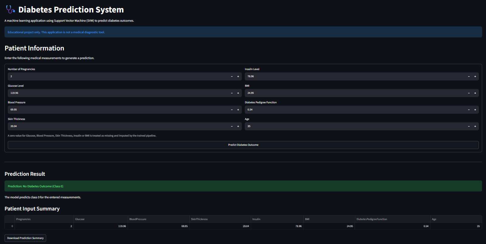

# 🩺 Diabetes Prediction System

A Machine Learning project that predicts whether an individual is likely to have diabetes based on medical diagnostic measurements using a Support Vector Machine (SVM) classifier.

The project combines Exploratory Data Analysis (EDA), data preprocessing, machine learning model development, and an interactive web application built using Streamlit.


## 🚀 Live Demo

**Try the application here:** [Diabetes Prediction App](https://diabetes-prediction-hrq5eyhsgmynzcy8gret4n.streamlit.app/)

Explore the application, enter patient health information, and view the prediction results.

---

## 📸 Application Screenshots



---

## 📌 Project Overview

Diabetes is a chronic medical condition that affects how the body regulates blood glucose levels. Early identification of potential diabetes cases can help individuals seek appropriate medical evaluation.

The objective of this project is to develop a machine learning classification model that predicts diabetes outcomes based on patient health-related attributes.

The trained model is integrated into a Streamlit web application where users can enter medical measurements and obtain predictions.

**Note:** This application is developed for educational and demonstration purposes only. It is not a substitute for professional medical diagnosis.

## 🎯 Project Objectives

- Perform Exploratory Data Analysis (EDA) to understand the dataset.
- Identify and handle invalid zero values in medical measurements.
- Preprocess data using missing-value imputation and feature scaling.
- Train a Support Vector Machine (SVM) classification model.
- Evaluate model performance using classification metrics.
- Develop an interactive Streamlit application for diabetes prediction.

## 📊 Dataset Description

The project uses the Pima Indians Diabetes Dataset.

The dataset contains medical diagnostic information and a binary target variable indicating diabetes outcome.

### Features

| Feature | Description |
|---|---|
| Pregnancies | Number of times pregnant |
| Glucose | Plasma glucose concentration |
| BloodPressure | Diastolic blood pressure (mm Hg) |
| SkinThickness | Triceps skinfold thickness (mm) |
| Insulin | 2-hour serum insulin (mu U/ml) |
| BMI | Body Mass Index |
| DiabetesPedigreeFunction | Diabetes pedigree function |
| Age | Age in years |
| Outcome | Target variable (0 = Non-diabetic, 1 = Diabetic) |

## 🔍 Exploratory Data Analysis

The following EDA techniques were performed:

- Dataset inspection and descriptive statistics.
- Diabetes outcome distribution analysis.
- Group-wise average feature analysis.
- Correlation heatmap to examine relationships between features.
- Boxplot analysis of glucose levels across diabetes outcomes.
- Feature distribution analysis using histograms.
- Identification of invalid zero values in medical measurements.

### Data Preprocessing

Zero values in the following columns were treated as missing values because zero is not a valid measurement for these attributes in this dataset:

- Glucose
- BloodPressure
- SkinThickness
- Insulin
- BMI

The missing values were handled using median imputation.

## 🤖 Machine Learning Model

A Support Vector Machine (SVM) classifier with a linear kernel was used for binary classification.

### Model Development Workflow

1. Separate independent features and the target variable.
2. Replace invalid zero measurements with missing values.
3. Split the dataset into training and testing sets.
4. Apply median imputation.
5. Standardize features using StandardScaler.
6. Train the SVM classifier.
7. Evaluate model performance.

### Model Pipeline

The Scikit-learn Pipeline integrates all preprocessing and classification steps:

```python
model = Pipeline([
    ('imputer', SimpleImputer(strategy='median')),
    ('scaler', StandardScaler()),
    ('classifier', svm.SVC(kernel='linear'))
])
```

### Train-Test Split

- Training data: 80%
- Testing data: 20%
- Random state: 1
- Stratification: Enabled

Stratified sampling maintains the original class distribution across training and testing datasets.

## 📈 Model Evaluation

The model was evaluated using:

- Training Accuracy
- Testing Accuracy
- Precision
- Recall
- F1-score
- Confusion Matrix

The classification report provides class-wise performance metrics, while the confusion matrix helps identify correct and incorrect predictions.

Actual performance metrics are generated by the training script and displayed in the Streamlit application.

## 🌐 Streamlit Web Application

The trained machine learning pipeline is saved using Joblib and integrated into an interactive Streamlit application.

### Application Features

**1. Diabetes Prediction**
- Enter patient medical measurements.
- Generate predictions using the trained SVM pipeline.
- View the predicted outcome.
- Download prediction summaries as CSV.

**2. Model Performance Dashboard**
- View training and testing accuracy.
- Examine the confusion matrix.
- View the classification report.

**3. Dataset Insights**
- Explore dataset records.
- View descriptive statistics.
- Analyze diabetes outcome distribution.
- Explore feature correlations.
- Visualize glucose distributions.
- Examine individual feature distributions.

## 🛠️ Technologies Used

| Technology | Purpose |
|---|---|
| Python | Programming language |
| Pandas | Data manipulation |
| NumPy | Numerical operations |
| Matplotlib | Data visualization |
| Seaborn | Statistical visualization |
| Scikit-learn | Machine learning and preprocessing |
| Joblib | Model serialization |
| Streamlit | Web application development |

## 📁 Project Structure

```text
diabetes-prediction/
│
├── Diabetes Prediction.py
│   └── EDA, preprocessing, model training and evaluation
│
├── app.py
│   └── Streamlit web application
│
├── diabetes.csv
│   └── Dataset
│
├── diabetes_model.pkl
│   └── Saved machine learning pipeline
│
├── requirements.txt
│   └── Project dependencies
│
├── .gitignore
│
└── README.md
```

## ⚙️ Installation and Setup

### 1. Clone the repository

```bash
git clone https://github.com/YOUR_USERNAME/diabetes-prediction-system.git
```

### 2. Navigate to the project directory

```bash
cd diabetes-prediction-system
```

### 3. Create a virtual environment

```bash
python -m venv venv
```

### 4. Activate the virtual environment

Windows:

```powershell
venv\Scripts\activate
```

### 5. Install dependencies

```bash
pip install -r requirements.txt
```

### 6. Generate the trained model (if needed)

If the saved model is not included in the repository, execute:

```bash
python "Diabetes Prediction.py"
```

This trains the SVM pipeline and generates `diabetes_model.pkl`.

### 7. Run the Streamlit application

```bash
streamlit run app.py
```

The application will open in your default browser.

Alternatively, access it at:

```text
http://localhost:8501
```

